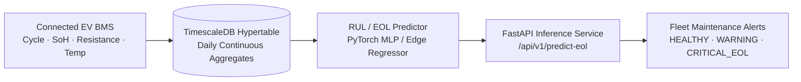

# EV Battery End-of-Life (EOL / RUL) CPS & MLOps Platform

[](https://github.com/mabdullah-ml/ev-battery-eol-cps-mlops/actions/workflows/ci.yml)
[](./LICENSE)
[](#)
[](#)

> 🌐 **[日本語ドキュメントはこちら (README.ja.md)](./README.ja.md)**

A **Cyber-Physical System (CPS)** IoT telemetry and **EV Li-ion Battery Remaining Useful Life (RUL) / End-of-Life (EOL)** prediction platform combining physics-informed degradation modeling, PyTorch & lightweight edge RUL inference, TimescaleDB hypertable analytics, FastAPI serving, and automated CI evaluation.

---

## Architecture



## Quick Start

```bash
pip install -e ".[dev]"
ruff check src tests
pytest -v
python -m ev_cps.model

# Start TimescaleDB + FastAPI inference stack
docker compose up --build
```

## Author

**Abdullah Mamun, Ph.D.** — Senior Generative AI / LLM Engineer · Data Scientist · PMP  
[GitHub](https://github.com/mabdullah-ml) · [LinkedIn](https://www.linkedin.com/in/mamunabdullah01)
